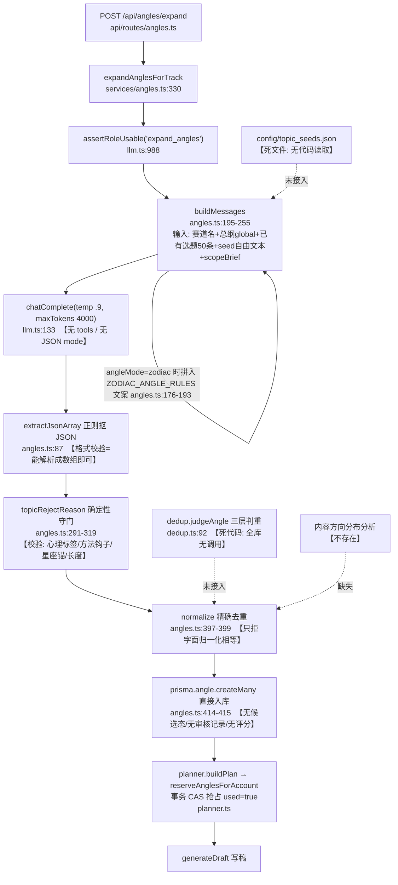
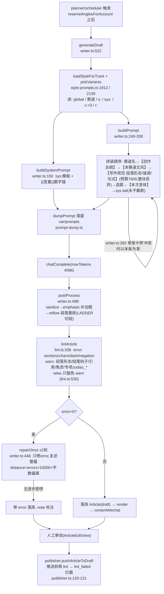

# 当前架构与真实业务流程

**日期**：2026-11-12 | 性质：只读验证稿 | 证据均为本次实读（行号取自当前工作区）

---

## 1. 模块地图（真实文件）

```text
server/src
├─ app.ts                    Express 装配；/api 全量 authGuard（app.ts:45）
├─ index.ts                  只起 HTTP（无内嵌调度器）
├─ constants.ts              安全红线 + 门禁数字唯一真源（:35-67）
├─ api/routes/               system auth users credentials tracks angles articles
│                            models revise plans emphasis scheduler dashboard style-prompts
│  api/bulk-delete.ts        批量删除骨架（语义与单条共用）
└─ services/
   ├─ writer.ts (681行)      写稿编排：配置→prompt→LLM→后处理→lint→修补≤2轮
   ├─ style-prompts.ts (2236) 配置单表读写 + 种子 + v2→v15 数据迁移区
   ├─ angles.ts (815)        扩库（生成即入库）+ 选题 CRUD + 归还/切片治理
   ├─ dedup.ts (147)         文本判重（judgeAngle 未接入 → 死代码）
   ├─ lint.ts (562)          成稿体检（error 拦推送 / warn 提示）
   ├─ track-rules.ts         赛道机器规则查表（checks/angleMode/relax）
   ├─ planner.ts (441)       排产 + CAS 抢占角度 + 落 Article
   ├─ scheduler.ts (441)     tick：按账号 automationMode 写稿/推草稿箱
   ├─ publisher.ts (273)     推草稿箱（推送前再 lint，lint_failed 拦截）
   ├─ llm.ts (1021)          chatComplete / generateImage / testModel
   ├─ model-registry.ts      模型域（vendor/protocol/capability/role）
   ├─ render/index.ts        contentHtml→contentWechat 唯一渲染
   ├─ parse/index.ts         只认 h1/h2/p/strong
   ├─ emphasis.ts / paragraph-reflow.ts / html-sanitize.ts   确定性后处理
   ├─ prompt-dump.ts         成品 prompt 落盘 var/prompts（KEEP=30）
   └─ comic/*                漫画产线（本次重构不动）
web/src
├─ App.vue (635)             壳层：侧栏分组菜单 + 顶栏标题/系统状态 + 主题
├─ router/index.ts (132)     13 页面；meta.title/desc；角色守卫（前端显隐≠安全边界）
├─ views/                    ArticleEdit 1201行 / StylePrompts 1193 / Models 997 /
│                            TrackAngles 948 / Tracks 804 / Dashboard 787 / Articles 557 …
├─ styles.css (520)          --wb-* 设计令牌（:8-63，含第二段"品牌扩展令牌"）
└─ components/               VariantLinesEditor BatchBar RowActions StateError BrandLogo
```

## 2. 选题链路（真实，含校验缺口标注）



**校验有无一览**：LLM 输出格式 ✅（可解析即可）｜字段长度 ✅（clip 500/64）｜正能量正则守门 ✅｜字面去重 ✅｜相似度去重 ❌（死代码）｜语义去重 ❌｜质量评分 ❌｜人工/审核态 ❌｜分布均衡 ❌。

**状态机现状**：Angle 只有 `used: Boolean` 一个消费位（+ usedBy/usedById/usedDate 归属），**没有候选/审核状态**——「生成→入库→可被排产抢走」是同一步完成的。

## 3. 写稿链路（真实）



**门禁数字**（`constants.ts:35-67`，代码常量、页面改不到）：小标题 3-4｜字数 1300-2300（目标 1800-2200）｜段数锚 17-19｜加粗 8-12 / 红字 2-3｜单段 150 字提示级。

**二次结构调整**：存在——`paragraph-reflow.ts` 按句边界+LADDER 阶梯重切段落（一个字不改、只动段落划分），`emphasis.ts` 补加粗。两者都是**生成后确定性改写**（与「不打补丁」新约束的关系见 PROMPT-AND-CONTRACT-DESIGN §6）。

## 4. 调度与推送链路

```text
cli/scheduler.ts（独立进程）→ scheduler.tick()（scheduler.ts:242）
  → 解析每账号 automationMode（User 行优先，无主回落 Setting 三键）
  → targets = 启用+credStatus=ok 的账号×产线
  → 写稿：planner 建 Article（auto_draft/auto_draft_push）
  → 推送：仅 auto_draft_push → publisher.pushArticleToDraft（只到草稿箱）
  → 全程 RunLog 记账（scheduler.ts:222 logRun）
```

Web 端另有手动入口：`/api/plan`（排产预览/出稿）、文章页推送按钮（人工确认）。

## 5. API 面（路由清单，全部经 authGuard，公开仅 /health 与 /auth/*）

| 前缀 | 职责 | 备注 |
|---|---|---|
| `/api/auth` | 登录(口令)/登出/状态/注册 | 管理令牌已退场（auth.ts:6） |
| `/api/users` | 用户审批/角色/expiresAt/maxOAAccounts | admin |
| `/api/credentials` | 公众号凭据 CRUD + 连通测试 | secretEnc 加密 |
| `/api/tracks` | 赛道 CRUD + pipelines 配额 | |
| `/api/angles` | 选题 CRUD + expand + 归还 + off-ip 治理 + bulk-delete | **无候选/审核端点** |
| `/api/articles` | 文章 CRUD + lint + 预览 + 推送 + 封面 + 漫画 | |
| `/api/models` | 模型 CRUD + meta/bindings/resolve/test | 路由顺序坑：/meta 等在 /:id 前 |
| `/api/revise` `/api/emphasize` | AI 改写（预览/应用两段式）/强调补全 | |
| `/api/plan` `/api/scheduler` `/api/dashboard` | 排产/调度开关/仪表盘 | |
| `/api/style-prompts` | 7 类配置 CRUD + /defaults + /cursor | 保存**无 schema 校验**（见 5.x） |

## 6. 关键事实核对表（本次新增发现）

| # | 事实 | 证据 |
|---|---|---|
| 1 | **无 prisma/migrations 目录**：没有版本化迁移历史；schema 变更靠 `db push`，数据迁移靠代码内 v2-v15 + cli 脚本 | `server/prisma/` 只有 schema×2 + dev.db + 9 个手工备份 |
| 2 | `dedup.judgeAngle`（三层判重）与 `nextCode` 是死代码 | 全库 grep 仅定义无调用 |
| 3 | `config/topic_seeds.json` 是死文件 | 仅 `config.ts:38` 注释提及 |
| 4 | `Article.qualityJson`、`Article.contentPath` 是死字段（零读写） | 全库 grep 零命中（`content-path.ts` 只管 coverPath） |
| 5 | `User.expiresAt`「到期降只读」**无执行点**（仅 CRUD 可改）；`maxOAAccounts` 同为预留 | grep 仅 users.ts 命中 |
| 6 | `Article.mediaId`（推送后微信 media_id）有写有读（publisher.ts:176-184）——活着 | 已验证 |
| 7 | `TaskRun.paramsJson/resultJson`、`RunLog.contextJson` 均在写（planner/publisher/comic/scheduler） | 已验证 |
| 8 | lint 保存/推送链路均生效；`PushResult.reason='lint_failed'` 真实存在 | publisher.ts:128 |
| 9 | 选题 prompt 的赛道文案（ZODIAC_ANGLE_RULES）硬编码在 angles.ts，配置页改不到 | angles.ts:176-193 |
| 10 | `sys:` 模板数字走 `{{变量}}` 同源注入；`s:`/`v:` 自由文本里的数字（如「9~12 个小节」）不受校验 | writer.ts:81-133 vs angles.ts:138 |
