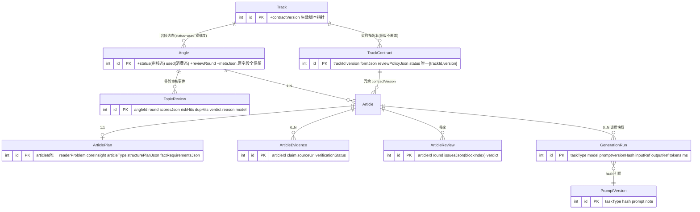

# 数据库审查与目标 ER 设计

**日期**：2026-11-12 | 只读验证：schema.prisma + dev.db(readOnly) + 全库字段读写 grep

---

## 3.1 当前数据库 ER（真实结构，非目标设计）

```mermaid
erDiagram
    Track ||--o{ TrackPipeline : "产线 article/comic"
    Track ||--o{ OAAccount : "挂账号"
    Track ||--o{ Angle : "角度池"
    Track ||--o{ Article : "文章(SetNull)"
    User ||--o{ OAAccount : "owner SetNull"
    User ||--o{ UserSession : "会话 Cascade"
    OAAccount ||--o{ WechatToken : "token缓存 1:1"
    OAAccount ||--o{ Article : "删号删文 Cascade"
    Angle ||--o{ Article : "选题引用 SetNull"
    Article ||--o{ ComicPanel : "漫画逐格 Cascade"
    LlmModel ||--o{ ModelBinding : "role唯一 1:1"
    TaskRun ||--o{ RunLog : "日志 Cascade"

    Track { int id PK "name slug quotaPerDay(废弃) enabled"}
    TrackPipeline { int id PK "trackId kind quotaPerDay enabled configJson"}
    OAAccount { int id PK "trackId ownerUserId name appid secretEnc secretMask author credStatus enabled"}
    User { int id PK "username passwordHash role status expiresAt maxOAAccounts automationMode writeTime"}
    UserSession { string id PK "userId expiresAt"}
    WechatToken { int id PK "accountId tokenEnc expiresAt"}
    Angle { int id PK "trackId code seq theme content scope used usedBy usedById usedByAccountId usedDate source"}
    Article { int id PK "trackId accountId angleId title digest contentHtml contentWechat contentPath coverPath coverMediaId coverUploaded mediaId status pushDate blocks chars qualityJson pipeline comicJson idempotencyKey note"}
    ComicPanel { int id PK "articleId seq prompt lines filePath wechatUrl uploadedKey status bytes attempt errorMsg"}
    TaskRun { int id PK "jobType status trigger parentId trackId accountId articleId angleId runDate attempt paramsJson resultJson errorCode errorMessage tokensPrompt tokensComplete"}
    RunLog { int id PK "taskRunId level stage message contextJson"}
    LlmModel { int id PK "name vendor protocol capability baseUrl modelId apiKeyEnc apiKeyMask paramsJson enabled"}
    ModelBinding { int id PK "role modelId"}
    Setting { int id PK "k v kind readonly desc"}
    StylePrompt { int id PK "key kind prompt"}
```



**索引**（schema 内声明）：Angle `@@unique([trackId,code])` + (trackId,scope,used,seq)/(trackId,used,seq)/theme；Article pushDate+accountId / status / angleId / pipeline+status / accountId+pipeline + `idempotencyKey` 唯一；TaskRun status+createdAt / jobType+runDate / articleId。〔已验证〕

**迁移历史**：`server/prisma/migrations/` **不存在**〔已验证〕。现状 = `prisma db push`（SQLite）+ 代码内数据迁移（`style-prompts.ts` v2→v15 哨兵式）+ `cli/migrate.ts`（本机数据导入）+ `scripts/migrate-track-config.ts`/`migrate-automation.ts`。**风险**：生产 MySQL 上线没有 baseline；schema 演进不可回滚。`deploy/README` 已有「上线前置项」提醒但未落地。

**迁移安全观（2026-11-12 用户裁定 P，实施时强制）**：
1. **down 演练成功 ≠ 数据回滚安全**——新增列/表可逆；重命名涉数据迁移；合并/拆分/删除可能无法无损逆向。不能安全 down 的迁移采用**向前修复**（forward-fix）策略，不强行回滚。
2. **结构变更与数据变更分开脚本**（DDL / DML 各自独立、各自可测）。
3. 流程：对生产 MySQL 建 baseline（先确认与实际 schema 一致）→ 隔离库验证 baseline → 迁移前备份并**验证恢复流程** → 生产发布前做 schema 差异检查。
4. **SQLite 开发库与 MySQL 生产库分别验证**——SQLite 迁移通过不代表 MySQL 安全（枚举降级、字符集、严格模式差异）。
5. 红线：**不允许直接拿真实生产库试验迁移**（与总纲 §二-8 同效）。

**数据分布**（2026-11-12 只读）：Track 6（育儿/职场/星座/科技/教育/激励）｜TrackPipeline 12（育儿双开，其余 article）｜Angle 33（21 未用）｜Article 12（全 draft）｜StylePrompt 41 行（global 1 + 赛道 6 + s: 6 + sys: 7 + v: 18 + r:星座 1）｜Setting 含 style_seed_v2…v15 共 14 个迁移标志｜TaskRun 11（全 write/success）｜User 3。

## 3.2 核心实体说明（职责 / 字段 / 读写点 / 兼容位）

| 实体 | 职责 | 核心字段 | 读方 | 写方 | 历史/废弃位 |
|---|---|---|---|---|---|
| **Track** | 赛道主数据 | name/slug/enabled | planner/tracks.ts/writer(名) | tracks.ts, migrate | `quotaPerDay` **已废弃**（真源=TrackPipeline，双写兼容，schema 注释明示） |
| **TrackPipeline** | 产线配额/开关/配置 | kind/quotaPerDay/enabled/configJson | pipeline.ts/planner/scheduler | pipeline.ts/seed-pipelines | — |
| **OAAccount** | 公众号凭据（AES 加密） | appid/secretEnc/credStatus/ownerUserId | publisher/wechat/planner | credentials.ts/accounts.ts | secretMask 只读投影 |
| **User/UserSession** | 登录用户+会话 | role/status/automationMode/writeTime | auth/permissions/scheduler | users.ts/auth.ts/scheduler.ts | `expiresAt`「到期降只读」**无执行点**；`maxOAAccounts` **无强制点**（仅 CRUD）→ 预留半成品 |
| **WechatToken** | token 缓存 | tokenEnc/expiresAt | wechat.ts | wechat.ts | — |
| **Angle** | 选题池（同时承担候选+正式+消费） | theme/content/scope/used/usedBy*/source/seq/code | planner(抢占)/angles CRUD/writer(input) | angles.ts(planner 改 used) | `used` 一个布尔承担消费态；**无审核态**；code/seq 仅为排序编码 |
| **Article** | 文章真源 | contentHtml→contentWechat/status/cover*/idempotencyKey | publisher/编辑页/render/dashboard | planner/writer/编辑/revise/emphasis/cover/publisher | **`qualityJson` 死字段**（零读写）；**`contentPath` 死字段**（零读写，文件化是 coverPath 不是它）；blocks/chars 活（统计列） |
| **ComicPanel** | 漫画逐格资产+行级状态机 | seq/prompt/status/uploadedKey | comic/*, render/comic | comic/panels.ts | — |
| **TaskRun/RunLog** | 任务级执行记录+日志 | jobType/status/paramsJson/resultJson/tokens* | dashboard | planner/publisher/comic/scheduler | 覆盖「任务」粒度，**不覆盖单次 LLM 调用快照** |
| **LlmModel/ModelBinding** | 模型域四维 | vendor/protocol/capability/role | llm/model-registry | models.ts | protocol 枚举含 2 个「预留未实现」值 |
| **Setting** | 系统设置 | k/v/readonly | 各处 | system.ts | `style_seed_v2…v15` 迁移标志 14 个=反模式证据 |
| **StylePrompt** | 7 类配置单表 | key(kind 6 种)/prompt(Text) | writer/angles/lint | style-prompts.ts | 无版本、无校验；key 约定字符串脆弱 |

## 3.3 未来实体逐一审查（8 个提案）

> 审查原则：真实业务价值优先；能并入现有表就不新建；每张新表都要回答「谁写、谁读、删了会怎样」。

### ① TrackContract（赛道形态契约）——**需要，砍半**（D4）

> ⚠️ 版本关系（2026-11-12 用户裁定，修正本文旧稿的"1:1"表述）：**TrackContract 与 Track 是多对一**——
> 每条 Track 可有多行契约（version 1/2/3…历史版本不得覆盖），由 `Track.contractVersion`（或发布记录）
> 指明当前生效版本。图示：`Track 1 ── N TrackContract(version) ──▶ 当前生效 = Track.contractVersion 指针`。

- **是否独立建表**：**是**（`TrackContract`，**N 行/Track，每行一个版本**）。理由：form 是**结构化对象**（要 schema 校验+算术校验+版本），塞进 StylePrompt 的 Text 列就重蹈「自由文本数字」覆辙。StylePrompt 继续存自由文本（文风/规范/变体），两表职责切开。
- **关联**：Track 1—N TrackContract（版本行，**旧版本永不覆盖**）；Article/TopicReview/ArticlePlan 各自冗余 `contractVersion`（当时生效的版本号，不是外键——追溯要的是"当时那版"）。
- **必带**：`version`（递增）、`formJson`、`reviewPolicyJson`、`status(draft/published/archived)`、唯一约束 `[trackId,version]`、索引 trackId。**生效指针**：`Track.contractVersion` 指向当前 published 行；发布=新版本行 + 移指针，旧行归档保留（回答「历史快照」：版本行本身就是快照）。
- **历史兼容**：现 6 赛道由种子生成 v1 行；StylePrompt 旧 key 原样保留（读取时优先 contract，缺则回落，过渡期完后停写）。
- **风险**：与 StylePrompt 双源漂移 → 规则写死：**数字类只存 contract，自由文本里禁止出现门禁数字**（保存校验拦）。

### ② PromptVersion——**需要，轻量实现**

- 独立小表：`taskType, version, hash, prompt(全文), note, createdAt`。按 `hash` 去重（同一文本只存一份）。
- **不是**每次运行存一份（那是 GenerationRun 的快照职责）——PromptVersion=模板档案，GenerationRun=运行快照，两者用 hash/version 关联。职责不重复。
- 索引 `[taskType, createdAt]`。兼容：现存 7 类配置落库时自动登记首版。

### ③ TopicCandidate（候选选题）——**不建独立表（原清单过度设计）**

这是本次审查对原方案最大的修正。对比两个方案：

| | A：独立 TopicCandidate 表（原清单） | B：Angle 加 `status` 状态机（推荐） |
|---|---|---|
| 结构 | 与 Angle 同构（theme/content/scope…）+审核字段 | Angle 加 `status` 枚举 + `metaJson` |
| 升格 | 候选行→复制成 Angle 行 | `status: candidate→approved` 一次 CAS 更新 |
| 防重复升格 | 需额外唯一约束/事务 | **天然幂等**（status flip 是 UPDATE WHERE status='candidate'） |
| 一致性 | 两表同构字段会漂移 | 单表无漂移 |
| 查询侵入 | 小（Angle 消费方不变） | 中（planner 取用加 `status='approved'` 过滤，一处改） |
| 体量适配 | 候选≫正式时隔离有价值 | 当前 33 条、日增 20-100 条，单表完全够 |

**结论：B**（2026-11-12 用户拍板 D1）。理由：① 与项目现有模式一致（Article 就是 status 枚举制，见 ArticleStatus）；② 「同一候选被重复升格」问题在 A 方案里反而要额外防，B 方案 UPDATE 天然防；③ 拒绝的候选 `status='rejected'` 留存即审计轨迹，不用另开坟场表；④ 少一张同构表=少一份迁移+少一处状态不一致。

**⚠️ 双维度铁律（用户裁定）**：`status` 只管**审核态**，`used` 只管**消费态**，两者不合并：

```text
status（审核态）：candidate ──┬── approved ──(used=true 由排产置)──▶ 已消费
                             ├── needs_revision ──┬── approved
                             │                    └── rejected
                             └── rejected
used（消费态）：false/true，仅在 approved 后有意义
「标重复」＝TopicReview 事件（verdict=rejected, reason=dup_*），不新增主状态
```

UI 五 Tab 映射：候选待审(candidate)｜待修改(needs_revision)｜正式题库(approved 且 used=false)｜已用(used=true)｜已拒绝(rejected)。
**附加字段**：`Angle.status` 四态枚举（存量 33 条回填 approved **前逐条人工检查实际状态，不无条件批量改**——D1 附带要求）、`Angle.reviewRound Int`、`Angle.metaJson`（六维评分依据/风险说明/判重结果）。
**索引**：`[trackId, status, seq]`（现 `[trackId,used,seq]` 演进）。唯一约束保留 `[trackId,code]`。
**仅当**未来出现「候选量级≫正式库、需物理隔离归档」再拆表——现在拆是为架构而架构。

### ④ TopicReview（选题审核记录）——**需要**

- 独立表，N:1 → Angle（`angleId` + `round`）。字段：scoresJson（六维）、riskHits、dupHits（命中的相似 Angle id+分数）、verdict(approved/needs_revision/rejected)、reason、model、promptVersionHash、contractVersion、createdAt。
- **要历史**：一候选多轮审核全留（回答「修改后重审如何追踪」）。索引 `[angleId, round]`、`[verdict, createdAt]`。
- 与 TopicCandidate 不同，这表**没有同构问题**（它是事件记录，不是数据本体）。

### ⑤ ArticlePlan（文章策划）——**需要，但第一版做轻**

- 独立表 1:1 → Article（`articleId` 唯一）。必要字段：`readerProblem, coreInsight, articleType, structurePlanJson(节/目的/要点), factRequirementsJson, contractVersion, model, createdAt`。
- **可模型生成**：coreInsight/structurePlan/factRequirements（一次小调用，~300 token）。**必须程序校验**：节数∈契约 sections 区间、factRequirements 类型合法、articleType∈契约 allowedTypes、structurePlan 条数=节数。
- **防计划与文章脱节**：writer 的 user prompt 注入 structurePlan 且成稿 lint 校验 `h2Count==len(structurePlan)`（误差 ±1 容忍）；不一致→按 error 修补或标 warn。
- **成本控制**：策划调用 maxTokens≤600；与写稿共用 write 角色模型（不必新绑）；可选「跳过策划」只给纯短文形态（由契约开关控制），不是全局开关。
- 多形态算术：**策划阶段不算字数配额**（字数算术属于契约校验，见 PROMPT-AND-CONTRACT §2），计划只管结构与事实需求——避免把「12 座×段均」这种形态账塞进计划。

### ⑥ ArticleEvidence（事实证据）——**需要**

- N:1 → Article。字段照方案 §6.4（claim/sourceTitle/sourceUrl/sourceType/publishedAt/accessedAt/evidenceExcerpt/verificationStatus/verificationNote）。
- 状态机 `pending→verified/unverified/rejected`；`[articleId, claimHash]` 唯一防重复登记。索引 `[verificationStatus]`。
- 无外部来源的文章**零行**，不是「有一行 unverified」——语义干净。
- 注意：sourceUrl 无须外键；来源可达性复检靠 verify 服务重跑，记录 `accessedAt`。

### ⑦ ArticleReview（文章审核）——**需要**

- N:1 → Article（`articleId + round`）。字段：scoresJson、issuesJson（问题+段落定位+建议）、verdict、reason、model、contractVersion、createdAt。
- 与 lint 的关系：lint 是**确定性子集**（每次运行现算，不落库），ArticleReview 是**审核事件**（落库）。避免把 lintReport 每次塞进 qualityJson 那种死字段模式——qualityJson 的教训就是「存了没人读」。
- 段落定位：要求 `blockIndex`（parse 后的块序号）而非模糊文本（UI 需求 5.6 要求稳定定位）。

### ⑧ GenerationRun（AI 运行记录）——**需要，但防膨胀设计前置**

- 独立表，N:1 可选 → Article/Angle（`bizType/bizId`）。字段：`taskType, model, promptVersionHash, contractVersion, inputRef, outputRef, outputHash, status, errorCode, tokens*, ms, createdAt`。
- **防重复**：与 TaskRun 分工——TaskRun=任务（一次排产/推送），GenerationRun=**单次模型调用**（一次写稿可能 3 次调用：生成+修补×2）。`taskId` 可选挂 TaskRun。
- **脱敏**：inputRef/outputRef 不存全量正文到行内——存 `prompt-dump` 文件路径 + 前 500 字摘要 + sha256；密钥/AppSecret/手机号正则脱敏后再落摘要。
- **增长控制**：`createdAt` 索引 + 保留策略（Setting: `run_retention_days`，**默认 30 天是建议值——执行清理前先确认实际合规与业务需求**，D 追溯决策）；大字段不进 MySQL 行（MySQL LongText 行会撑爆 buffer pool）。
- **追溯**：Article → ArticlePlan.contractVersion + GenerationRun(promptVersionHash, model) + ArticleReview + Evidence 全链可查（PLAN §9.3 的追溯链由此闭合）。**历史文章（改造前 12 篇等）没有真实追溯记录的标 `legacy`，只展示实际存在的信息，不得伪造**（决策 C）。

### 不建的表（明确砍掉）

| 提案 | 处置 | 理由 |
|---|---|---|
| TopicCluster | **不建**（离线脚本产物） | 方案自己也标"建议"；分布分析先当报表算，不成实体 |
| TopicHistory | **不建**（用 status=used 的 Angle + Article.title 视图） | 职责与 Angle 完全重复 |
| 传统素材库 | **不建**（红线） | PLAN §6 明确不做 |

## 目标 ER（推荐）与差异



**与当前 ER 的差异一览**：
1. 新增 6 表：TrackContract、TopicReview、ArticlePlan、ArticleEvidence、ArticleReview、GenerationRun、PromptVersion（7 张，均轻）。
2. **Angle 加列**（status/reviewRound/metaJson）而非新增 TopicCandidate 表——33 行存量回填 approved，零数据损失。
3. Article 加 `planId`（或 plan 侧 articleId 唯一反查，二选一，推荐后者少改 Article）；`qualityJson`/`contentPath` 停写不删（标记 @deprecated）。
4. **补 migration 体系**：立即建 `prisma/migrations/` baseline（当前空目录=上线阻断项）。
5. Setting 的 14 个 style_seed_* 标志随迁移区封版后清退（保留行，只归档）。

**数据一致性防线**（回答「会不会状态不一致」）：
- 升格/审核状态只走单点事务 UPDATE（CAS），杜绝双写；
- contractVersion 一律冗余快照值，不设外键（版本行永不改写）；
- GenerationRun 只存引用+hash，全量文本在 prompt-dump 文件（30 份滚动），文件丢了不影响主数据。
