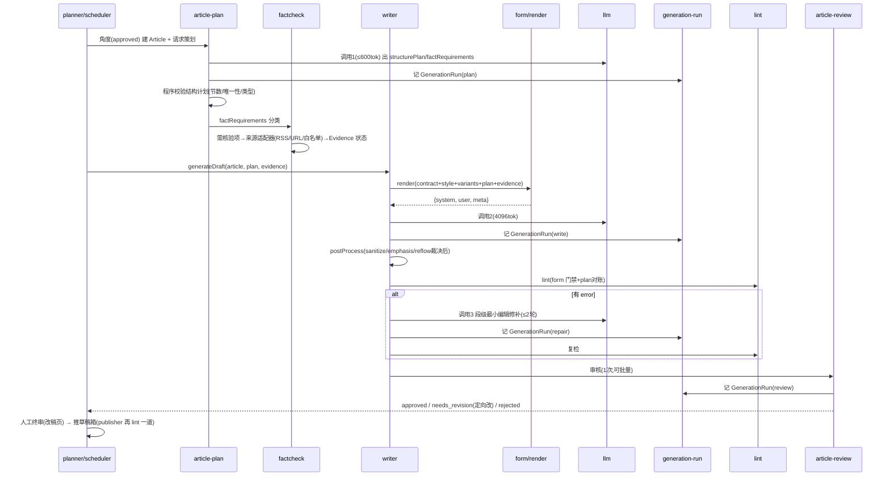

# 形态契约、配置与 Prompt 的最终关系

**日期**：2026-11-12 | 只读验证稿 | 对应审查任务 §5（最重要）与 §6（Prompt 体系）

---

## 5.1 当前真实机制（先解释现状）

**Q1 一个赛道有哪些配置？** 7 类，全部落在 `StylePrompt` 单表（key 约定字符串），另有代码常量与代码内文案：

| 配置层 | 当前存储位置 | 当前作用 | 使用环节 | 优先级（实测） | 存在问题 |
|---|---|---|---|---|---|
| ① 全局总纲 `global` | StylePrompt(key=global) | 正能量/事实/逻辑底线 | 写稿 user prompt + 扩库 charter | 中（先拼但可被后文覆盖） | 与扩库"方法钩子"条款耦合（angles.ts:215） |
| ② 赛道文风 `{赛道}` | StylePrompt | 身份/读者/语气/语汇/禁忌 | 写稿 user prompt | 中 | 纯自由文本，无法校验 |
| ③ 系统提示词 `sys:{赛道}` | StylePrompt（`## system`+`## tail`，8 个 `{{变量}}`） | 结构/形态/硬禁令 + 收尾指令 | 写稿 system 消息 + tail | 高（system 不受预算截断；tail 永不截断） | 数字走变量✅，但结构条款与骨架卡重复 |
| ④ 写作规范 `s:{赛道}` | StylePrompt（`## 段落形态/强调标注/句式补充`） | 段落/强调/句式 | 写稿 user（预算 7600，整块丢弃 <60%） | 中低（会被预算丢块） | 段落形态与 ③⑤ 三处重复 |
| ⑤ 变体 `v:{赛道}:{title,structure,length}` | StylePrompt（`---` 分隔多条） | 反模板化轮换（cursor 递增） | 写稿 user tail | **最高**（writer.ts:282「冲突时以本条为准」） | 骨架卡可覆盖 ③④；v: 里的数字不受校验 |
| ⑥ 机器规则 `r:{赛道}` | StylePrompt(JSON) + `track-rules.ts` 种子 | 体检项 checks / 选题形态 angleMode / 豁免 relax | lint + 扩库守门 | 查表（relax 只豁免 warn） | 只有 `r:星座` 一行落库，其余走代码种子 |
| ⑦ 门禁数字 | `constants.ts:35-67` 代码常量 | sections/chars/段数/强调密度 | lint + prompt 变量注入 | **最高**（页面改不到） | 全局一刀切 → 与群像形态算术矛盾 |
| ⑧ 代码内 Prompt 文案 | angles.ts(ZODIAC_ANGLE_RULES/charter/scopeBrief)、writer.ts(REPAIR_SYSTEM/repairInstruction)、revise.ts | 选题守门/修补/改写 | 扩库/修补/改写 | 视位置 | **配置页改不到**，违 §3.4 |
| ⑨ 选题种子 `topic_seeds.json` | config/ 文件 | （历史）维度种子 | **无** | — | 死文件 |

**Q3/Q4 选题与写稿各用哪些配置？** 选题：①(global→charter)+⑥(angleMode 切 ZODIAC 规则)+⑧(文案)+scopeBrief。写稿：①②③④⑤⑥⑦ 全上。

**Q5 骨架卡/StylePrompt/TrackRule/constants 关系**：同属"写稿约束"但**四个来源没有仲裁机制**，只有拼接顺序；骨架卡（⑤）带最高优先级声明，constants（⑦）是 lint 的最终裁判。

**Q6 拼接顺序**（writer.ts:240-338）：赛道名→①→②→④(预算裁剪)→选题→⑤→③-tail。system 消息=③-system（数字注入）。

**Q7 冲突时谁赢**：文档上"骨架卡赢"（⑤>③④）；**实际上 lint 赢**（⑦——写出来不合门禁照样拦推送）。即：提示词层 ⑤ 最大，产物层 ⑦ 最大，中间没有一致性保证 → "规则互相打架"的结构根源（P1）。

**Q8 lint 阈值与 Prompt 一致吗**：`{{变量}}` 注入的部分一致（同源于 constants+篇幅档，writer.ts:113-133）；`s:`/`v:` **自由文本里手写的数字不受控**（如 angles.ts:138 "9~12 个小节"与 lint 的 3-4 小节门禁是两个体系——一个管选题期望、一个管成稿门禁，本身又无说明）。存在"页面写 5 节、lint 按 3-4 拦"的历史事故已被变量机制修掉，但只修了 `sys:` 一处。

**Q9 生成后程序二次调整**：**有**——`emphasis.ts`（补加粗至 8-12）、`paragraph-reflow.ts`（LADDER 阶梯重切段落，实测 16.3 段→25.1 段）。reflow 是"事后切分段落"，恰是新硬约束 4 要禁的行为（裁决见 §6）。

**Q10 为什么形态不稳/赛道趋同/规则打架**（按权重）：
1. **形态契约无单一真源**（四处规则+骨架卡最高优先级）→ 每次生成抽到不同变体=不同骨架；
2. **模型兼管结构归属**（同座多段这类全局约束提示词管不住，实测 20 篇仅 2 篇干净；zodiac_dup 只 warn 不拦）；
3. **门禁与形态算术不匹配**（12 座×74 字+5 场景=1258<1300）→ 模型加段凑字 → 段数膨胀/重复；
4. **共用 12 条 system 的历史惯性**已改（sys: 分赛道），但 ⑤ 骨架卡仍把结构拉回同一套"场景开场→误判→转折→回扣"；
5. 修补循环（复述整篇、≤2 轮）修不动否定框架这类文体禁令 → error 卡推送。

## 5.2 目标配置分层与优先级（最终推荐）

### 四层职责（回答四个"谁负责"）

| 问题 | 答案 | 落点 | 执行方式 |
|---|---|---|---|
| **文章应该长什么样？**（形态） | **形态契约（程序+契约定义）**：节数/字数/段数/节奏/主体清单/算术 | `TrackContract.form`（结构化 JSON） | 程序校验（schema+算术）+ `{{变量}}` 注入 prompt；lint 按同一 form 门禁 |
| **文章应该怎么写？**（表达） | **赛道文风+变体**（交给模型） | StylePrompt `②{赛道}`+`s:` 句式禁忌+`v:` 变体 | 自由文本进 prompt；变体轮换反模板 |
| **不能违反什么？**（底线） | **全局总纲+门禁**（程序为主） | `global`（红线文案）+ constants 宪法边界（chars∈[1000,4000] 等硬界）+ lint error | 合规门禁拦推送；文案进 prompt 只是宣导 |
| **最终符合要求吗？** | **lint（确定性）+ ArticleReview（语义）+ 人工** | lint.ts + ArticleReview + 审核 UI | 三级：机器门禁→AI 审核→人工终审（推送仍人工确认） |

### 推荐分层（配置收敛：7 类→4 层）

```text
L0 宪法（constants）        硬边界+安全红线，代码常量，永不可配
L1 形态契约（TrackContract） form: rhythm/sections/chars/paraMax/subjects/allowedTypes
                             + reviewPolicy（硬性风险项/豁免）    ← 数字唯一真源
L2 表达层（StylePrompt）     ②赛道文风（怎么说话）③sys 的"写法指导"部分
                             ④s: 句式禁忌（段落形态→迁 L1）⑤v: 变体（骨架卡降级）
L3 机器规则（r:）            checks 定制项（专项体检开关）；relax 仅逃生门
```

迁移映射：`s:段落形态` → `form.rhythm`（essay/mixed/list/sliced 派生判据）；`s:强调标注` 的密度数字 → `form.emphasis`；`v:structure` 骨架卡 → 保留但**降级**（与 form 冲突时 **form 赢**，删掉"以本条为准"条款）；`r:.relax` 从日常配置降级为例外。

### 冲突仲裁顺序（必须写进代码注释与文档）

```text
L0 宪法/门禁  >  L1 形态契约  >  ArticlePlan 结构计划  >  L2 变体骨架卡  >  L2 文风/规范自由文本  >  模型即兴
     ↑                ↑                  ↑
   lint 拦截      保存时算术校验      成稿 h2Count 对账
```

- Prompt、契约、Plan 冲突：**渲染期**统一由 Renderer 消解（数字只从 form 注入，自由文本模板禁止含数字——保存校验用正则拦门禁数字）；
- 产物与契约冲突：**lint 按 form 判 error**（拦推送，不自动改稿）；
- ArticlePlan 与成稿冲突（节数对不上）：error 级修补指令（定向改）或降级 warn（±1 容忍）；
- lint 与 ArticleReview 冲突：lint 是硬门禁（不可被审核分数抵消），Review 管语义维度；
- **人工终审永远在最后**（推送人工确认红线不动）。

### 规则强度三分（2026-11-12 用户裁定，防止契约变成过度约束工具）

契约与 lint 的每条规则必须标级，混级=设计错误：

| 强度 | 含义 | 例 | 执行 |
|---|---|---|---|
| **硬性** | 不可违反，违反即拦 | 安全红线、破折号/否定框架禁令、字数门禁上下限 | lint error 拦推送 |
| **目标** | 合理区间，偏离提示 | 目标字数 1800-2200、段数锚、强调密度 | prompt 目标 + lint warn |
| **软性** | 仅参考建议 | 风格偏好、示例写法 | 进 prompt，不校验 |

**算术校验不是单一固定公式**：`主体数×主体段均 + 开场 + 场景段 + 结尾` 只是估算模型——必须**按 rhythm 选式**（sliced/list/essay/mixed 各有各的式子与参数），且校验结论分「硬性不成立→拒存」「目标偏离→提示」两档。D3 边界：第一版只参数化按赛道变化项（字数区间/小标题数/主体清单/节奏/段落限制/强调数量/对应质量规则），**不把每条 lint 都做成后台配置**。

**程序约束 vs 模型 vs 人工**：程序=数字/结构/去重/门禁（确定性可测）；模型=内容、表达、语义审核、事实归纳；人工=终审、例外放行、风格拍板。**禁止**把"数段数、归属唯一性、字数"这类全局计数交给模型自觉——它做不稳（实测）。

### Prompt Renderer（唯一拼装入口）

```text
form/render.ts
  render(topic, plan?, contract, stylePrompt, variants, evidence?) → {system, user, meta}
  - 数字只来自 contract.form + 篇幅档（{{变量}}注入，unknown 变量告警）
  - meta = {contractVersion, promptHash, variantCursor, taskType}   ← 直接喂 GenerationRun
  - 选题生成复用同一 Renderer（taskType='expand_angles'）——消灭 angles.ts 内联文案
```

## 5.3 ArticlePlan 是否必要（逐问）

**结论：必要，但做轻**。它是 SECOND-OPINION「计划先行（D）」的落点——唯一性这种全局约束必须在"清单阶段"由程序校验（12 个座名恰好一次，好验），而不是在 20 段正文里赌模型自觉。

| 问题 | 答案 |
|---|---|
| 必要字段 | readerProblem、coreInsight、articleType、structurePlan（节数+每节目的+要点）、factRequirements、contractVersion |
| 模型生成 | 全部内容字段（一次 ≤600 token 小调用；清单纯输出时更小） |
| 程序校验 | articleType∈allowedTypes；节数∈form.sections；structurePlan 条数=节数；factRequirements 类型枚举合法；sliced 形态时**主体清单个数=契约 subjects 派生数、无重复**（唯一性在这步锁死） |
| 计划与成稿对账 | lint 新增 `plan_sections` 检查：h2Count 与 structurePlan 条数 ±1；sliced 形态 `subjectDup`（同主体多段）升 error |
| 防脱节 | writer 的 user prompt 注入 structurePlan 全文；修补指令带"第 N 节偏离计划"定位 |
| 成本控制 | 与 write 共用模型；可按 `form.plannable=false` 跳过（纯短文形态）；批量排产时按需（先文后策）可后置 |
| 多形态算术 | **不做**「统一章节数/字数算术」——字数算术在**契约层**按形态算（保存时校验），计划只管结构与事实。星座群像=12 主体×1 段+场景段，职场清单=4 拍清单——各有各的式子，由 `form.rhythm` 选式 |

## 6. Prompt 体系与 AI 运行管理

**Q1 重复定义**：有——段落形态在 ③④⑤ 三处；数字在 ⑦+⑤ 自由文本；"禁否定框架"在 sys、s:、REPAIR、revise 四处。
**Q2 硬编码赛道规则**：有——`angles.ts:176-193 ZODIAC_ANGLE_RULES`、`lint.ts` 的 zodiac 专项正则（词表在 constants）；track-rules.ts 的 `DEFAULT_TRACK_RULES` 键=赛道名（种子可以，运行分支已查表化✅）。
**Q3 可追溯**：现在改 prompt=改 StylePrompt 行（无版本，覆盖即丢）+ style_seed_vN 迁移（有日志无版本库）→ **不可追溯**。
**Q4 模板版本 vs 运行快照**：必须分开——PromptVersion（模板档案，hash 去重）/ GenerationRun（每次调用快照：用的哪版 hash+输入摘要）。
**Q5 GenerationRun 记什么**：taskType、bizType/bizId、model、promptVersionHash、contractVersion、inputRef/outputRef（文件路径+前 500 字摘要）、outputHash、status/errorCode、tokens/耗时、createdAt。
**Q6/Q7 脱敏与瘦身**：摘要正则打码（AppSecret/apiKey/手机号/身份证）；**全量 prompt 正文不进 DB**（prompt-dump 文件滚动 30 份）；正文内容不进日志（RunLog.contextJson 只放统计与 ID）。
**Q8 增长控制**：retention 30 天（Setting 可配）+ 每日清理 job + createdAt 索引；TaskRun/RunLog 同策略。
**Q9 追溯链**：Article →(planId)→ ArticlePlan.contractVersion → GenerationRun(promptVersionHash, model) → PromptVersion.prompt 全文 + ArticleReview + Evidence。一键查询接口 `GET /api/articles/:id/trace`。
**Q10 不必要的模型调用**：现有链路 1 次生成+≤2 修补是必要的；**新增调用要克制**——选题审核（六维）与文章审核（语义维）各 1 次/对象，且**批量审核允许一次调用判多条**（输入多候选，输出多 verdict，省钱）；策划 1 次小调用。事实核验的"来源是否支持主张"用确定性规则+人工抽查起步，LLM 复核按需。

### 推荐 Prompt 体系结构图

```text
                    ┌─ PromptVersion(taskType, hash, 全文) ── 模板档案
TrackContract.form ─┤
StylePrompt(表达层) ─┤
variants(cursor轮换) ─┤
ArticlePlan ──────────┤
evidence(已核验) ─────┘
        │
        ▼
 form/render.ts ──► {system, user, meta{contractVersion, promptHash, cursor}}
        │                    │
        ▼                    ▼
   llm.chatComplete     GenerationRun(快照/脱敏/引用)
        │
        ▼
 postProcess → lint(form 门禁) → 定向修补(段级最小编辑) → Article → ArticleReview → 人工 → 推草稿箱
```

### 一次文章生成的完整调用链（目标态）



### 与"不打补丁"约束的边界（reflow/emphasis 裁决——D2 已定，2026-11-12）

| 功能 | 裁决 | 边界 |
|---|---|---|
| `reflowParagraphs` | **限定保留，先验证再定默认开关** | 只做排版级切分（单段>paraMax 切段）；**禁止**加段/改写内容来掩盖生成结构错误；用现有文章样本做切分前后对照测试（段落数、长度变异系数、结构完整性、阅读效果）后，再决定 `form.postprocess` 默认开还是关（sliced/list 建议默认关） |
| `emphasis` | **保留** | 只处理格式（加粗/红字标注密度），**不得改变表达含义** |
| 自动增加主体段落 | **禁止** | — |
| 为满足字数自动补写内容 | **禁止** | — |
| 自动修复结构错误 | **禁止**，只能走明确的定向修改流程 | 定向修改=段级最小编辑+人工确认 |

总原则（用户裁定）：**先让模型生成符合结构的内容，再由程序验收；而不是先生成不合格内容，再靠程序修补。**
否定框架修复三件套见 RESTRUCTURE-ROADMAP-V2 阶段 4（前置替代表达进 system + 段级最小编辑 + error 保留；verify-negation 量化回归，修补成功率 <70% 触发降级决策留档）。
