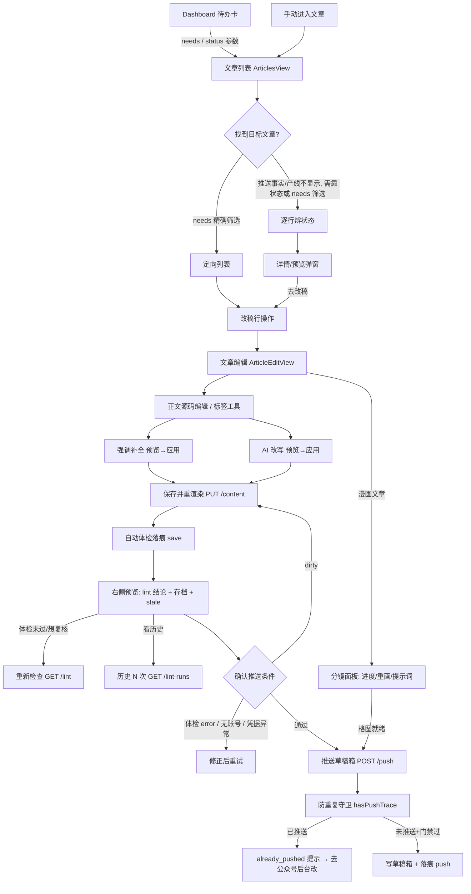

# S5-UI-3-0 · 文章工作台现状与改造切入点审计报告

**日期**：2026-11-17
**性质**：**只读审计**。未修改任何 `web/src/**`、`server/**`、API、Schema、Migration、`.env`；未连库、未调用 LLM/微信、未执行推送、未改业务状态机/体检规则/推送门禁；未执行 Git 写操作。**本轮唯一新增文件为本报告。**
**结论**：文章工作台 8 步使用流程（找文章→懂状态→进工作区→编辑保存→看体检→处理问题→确认推送→推草稿箱）全部可在现有 UI 内走通，**未发现 P0 / P1**。问题集中在「信息完整性 / 一致性」（P2）与「组件一致性 / 细节」（P3）。**具备进入 S5-UI-3-1 实施的条件**，建议下一批聚焦「列表信息层 + 反馈口径」，不重写两个页面。

---

## 1. 审计范围与环境

### 1.1 必读基线（均已实读）
`RESTRUCTURE-2.0-CONVERGED-PLAN.md`、`00-FINAL-EXECUTION-CHARTER.md`、`TARGET-UI-ARCHITECTURE.md`、`DEVLOG.md`、`WRITING-PIPELINE.md`、`web/UI-GUIDE.md`、`S5-UI-2-D-4-DASHBOARD-TODO-CLOSURE-AUDIT.md`、`S4-3-IMPLEMENTATION-REPORT.md`、`S4-4-0-STATE-LIFECYCLE-AUDIT.md`。
> S5-UI-0 / S5-UI-1 无独立报告文件（仓库实际文件为准）；其内容已并入 `UI-GUIDE.md` 顶部 S5-UI-1 变更摘要与 DEVLOG（11:05 条），本轮据此核对。

### 1.2 代码核查范围（逐文件实读）
| 层 | 文件 |
|---|---|
| 前端页面 | `web/src/views/ArticlesView.vue`（626 行全文）、`web/src/views/ArticleEditView.vue`（1367 行全文） |
| 前端支撑 | `web/src/api/index.ts`（文章段 262–381）、`web/src/types.ts`（754–943）、`web/src/utils/format.ts`（状态词表）、`web/src/utils/todo-nav.ts`（articlesNeedsQuery）、`web/src/views/DashboardView.vue`（待办跳转） |
| 服务端 | `server/src/api/routes/articles.ts`（列表/详情/删除/预览/lint/lint-runs/content/push）、`server/src/services/publisher.ts`（防重复+门禁）、`server/src/services/dashboard.ts`（todoArticles 口径）、`server/src/services/render/index.ts`（title/digest 派生） |
| Schema | `server/prisma/schema.prisma`（`Article` 342–392、`ArticleLintRun` 433–450、`ArticleStatus` 枚举） |

### 1.3 验证方式（如实分级）
- **主要方式：代码只读核查**。本报告的功能清单、状态映射、链路、权限、问题，均来自上述文件的逐行核对，精确到行号。
- **浏览器验证：复用 D-4 已完成的实测，本轮未新增**。D-4 报告 §5 已用真实 `web/dist` + Mock + headless Chrome 实测过文章链路的浏览器侧：`/articles?needs=draft_unpushed|repush` 的行数与提示、needs 刷新/清除/非法值、体检明细点进 `/articles/:id` 的体检面板与「最近存档」、深色/500px 窄屏、控制台 0 error。
- **未实测项（如实标注）**：本轮 Mock 夹具（`var/tmp/s5ui2c/mock.mjs`）仅覆盖 `/api/articles` 等 9 个端点，**不含改稿页的 `/articles/:id`、`/:id/preview`、`/:id/lint-runs`**；按任务书「不新建复杂测试框架、Mock 可直接复用才做」的约束，未为改稿页扩 Mock、未新增浏览器走查。改稿页相关结论为**代码核查通过**，非浏览器实测。
- `web/dist` 构建于 14:19，晚于两个核心页面源文件（13:20 / 11:02），代码与产物一致。

---

## 2. 当前文章列表功能清单（ArticlesView.vue）

| 维度 | 现状 | 证据 |
|---|---|---|
| 页面骨架 | `PageHead`（标题「文章」+ 描述含总数与「只进草稿箱、不会群发」红线）+ 刷新按钮 | `ArticlesView.vue:298-302` |
| 筛选条件 | 状态（草稿/已推送/已更新/失败）、选题下钻 tag（`angle`）、产线（文章/漫画）；全部存 URL query | `:59-95, 327-370` |
| 待办专项筛选 | `needs=draft_unpushed\|repush`；提示条说明条件、禁用状态/产线下拉、定向空态、清除筛选；非法值回退普通列表 | `:76-90, 307-322, 432-452` |
| 状态展示 | `StatusTag kind="article"`，文案=草稿/已更新/已推送/失败（技术状态如实展示，**未包装成审核状态**） | `:404-408`，`format.ts:24-29` |
| 文章 vs 漫画 | **仅有产线筛选下拉**；表格无产线列、无漫画视觉标识；`pipeline` 未被列表接口返回（见 §6） | `:355-369`，`articles.ts:357-394` |
| 推送事实 | **表格不展示** `mediaId`/`pushDate`；详情弹窗也不展示；仅改稿页底部显示 mediaId | `:380-429, 509-537`，`ArticleEditView.vue:982-984` |
| 批量操作 | `BatchBar` + `useBatchDelete`（仅批量删除）；勾选跨页保留、换筛选清空；impact 文案按 `status==='pushed'` 判「已推送」 | `:129-166, 373-378` |
| 行操作 | `RowActions`：详情/预览、改稿、推送草稿箱、删除（1 主 + 菜单，符合 UI-GUIDE） | `:266-293, 421-428` |
| 预览弹窗 | 详情 + 实时渲染并行拉取；展示封面/状态/ID/账号/统计/warnings/正文；底部「去改稿」 | `:180-203, 476-570` |
| 分页/空态/错态/加载 | 分页条 + 3 类定向空态 + 通用空态 + `StateError` + `v-loading`，齐全 | `:297, 304, 431-473` |

---

## 3. 当前文章编辑页功能清单（ArticleEditView.vue）

| 维度 | 现状 | 证据 |
|---|---|---|
| 标题编辑 | **无独立输入框**。标题 = 正文 `<h1>` 经渲染加前缀「【话】」派生；改标题须改正文 h1 | `:628, 897`；`render/index.ts:88-91`；`articles.ts:644` |
| 摘要编辑 | **无独立输入框**。摘要 = 正文首段前 54 字派生 | `:900`；`render/index.ts:111-115` |
| 正文编辑 | HTML 源码 `<textarea class="src-editor">`（刻意不用富文本，UI-GUIDE 允许自研）；配 H2/段落/加粗/红字标签工具 | `:780-788, 769-778` |
| HTML 源码编辑 | 与正文编辑为同一 textarea（所见即所存） | `:781-788` |
| 微信预览 | 右侧 pane，`previewArticle` 走同一渲染函数，「所见即所推」；可手动「重渲染」 | `:871-879, 978`；`articles.ts:475-552` |
| 保存状态 | 自定义 `dirty` + 「未保存/已保存」tag + 保存按钮；**未用 S5-UI-1 的 `SaveBar` 组件** | `:66, 761-767, 861-867`；`format.ts:97` |
| 未保存离开保护 | `onBeforeRouteLeave` + `beforeunload` + `Ctrl/Cmd+S` 保存，三重齐全 | `:359-386, 365-370` |
| AI 改写 | `previewRevise`（只改编辑框、不落库）/ `applyRevise`（写库+自动体检落痕 `trigger=revise`）两步；3 种模式 + 补充要求 | `:486-529, 839-859`；DEVLOG 11-16 21:45 |
| 强调补全 | `previewEmphasis` / `applyEmphasis` 两步；min/max/红字≥ 可调 | `:449-480, 790-837` |
| 封面 | 弹窗生成（画面描述/尺寸/宽高比），成功后自动 `load()` 刷新 | `:531-560, 990-1035` |
| 文章体检 | lint 面板：通过/未通过 tag、复合长段落/一句一段统计、**问题列表（error 红/warn 灰）**、存档行、「重新检查」、历史 popover、stale 标签 | `:910-966` |
| 体检历史 | `listArticleLintRuns`（只读），「历史 N 次」popover 展示时间/入口/结论 | `:150-157, 933-947` |
| stale 判断 | `lintRunStale = lastRun.contentHash !== htmlFingerprint(contentHtml)`，前端显示「存档已过期」 | `articles.ts:534-548`，`ArticleEditView.vue:929` |
| 存档失败提示 | `lintPersistError` 显式告警「刷新后不可追溯」，不冒充正常检查 | `:949-956, 179-186, 405-409, 581-584` |
| 漫画分镜 | 独立顶部卡片：进度条、格图、逐格状态（已生成/失败N次/待重试/待生成）、重画、提示词编辑弹窗、后台轮询 | `:194-338, 656-756` |
| 推送 | dirty 拦截 → 确认框 → 结果按 `reason` 分类（lint_failed / already_pushed / pushing / everPushed / errcode）展示 | `:562-619` |
| 推送门禁展示 | 预览区显示「体检通过，可推送 / 未通过，推送会被拦下」；门禁与展示同一套 lint 规则 | `:911-920`，`publisher.ts:186-229` |
| 防重复推送 | 前端正确展示 `already_pushed` / `pushing` 业务拦截文案（非微信报错） | `:592-604`；`publisher.ts:115-135` |

**任务书 §4.2 七问直答**：
1. **是否堆太多操作**：是——单页含正文/标签/强调/改写/保存/推送/封面/体检/历史/漫画分镜/提示词弹窗。但分区清晰（左编辑、右预览、漫画单独卡片），不算混乱。
2. **是否易区分各功能**：基本能（各有独立工具条/面板），但「强调补全」与「AI 改写」两条工具条紧邻、按钮结构相同（预览+应用），初见易混。
3. **正文非技术障碍**：存在（HTML 源码编辑），但为有意取舍（UI-GUIDE 明确允许、任务书不要求富文本），有标签工具缓解。
4. **体检问题能否定位处理**：能看到问题文字，但**不能点击定位到正文段落**——`ArticleLintIssue` 只有 `level/code/message`，无 `blockIndex`，TARGET-UI-ARCHITECTURE §7.3 设想的「点击问题→滚动定位段落」未实现；用户需通读全文自行找。
5. **保存/改写/体检/推送误操作风险**：防护较全（dirty 拦推送/重检查/离页；改写应用后自动体检；推送二次确认）。「预览改写/预览补全」会把结果写入编辑框并置 dirty，直接推送会被 dirty 拦截——合理。未见明显误操作缺口。
6. **漫画是否与普通文章混杂**：相对独立（单独卡片 + 「脚本预览（推送时替换为插图序列）」文案 + 体检只对文章产线加载），但同页仍显示正文编辑与强调/改写条（用于改台词脚本），可接受。
7. **可布局改善且不需后端的项**：列表补推送事实列（数据已返回）、列表推送反馈对齐改稿页、批量删除 impact 改用推送痕迹口径、SaveBar 统一、强调/改写工具条视觉区分。

---

## 4. 文章状态与推送事实对应关系

### 4.1 权威口径（S4 已定，本轮不改）
- `ArticleStatus` 枚举仅四值：`draft / pushed / updated / failed`（`schema.prisma:25-30`）。
- `status` 是**会被覆盖的当前态**：保存正文 `pushed→draft`、改写/强调 `pushed→updated`、重推失败（曾送达）保持、`cover.ts` 换封面 `pushed→draft`（S4-4-0 §2.2）。
- **推送事实的唯一判据是 `hasPushTrace(a)`**（`mediaId`/`pushDate` 任一非空），**不看 status**（S5-1；`article-delete.ts` / `publisher.ts:120`）。
- 防重复推送守卫在 `pushOnce` **最前面**：有推送痕迹直接返回 `reason:'already_pushed'`，不触达微信（`publisher.ts:115-135`）。
- **本系统不支持原地更新草稿**：`WechatClient.updateDraft` 零调用（`publisher.ts:14-17`）。用户改稿后想同步到公众号，只能在公众号后台手动改。

### 4.2 状态-事实-UI 映射表（任务书 §4.4）

| 业务情况 | 实际数据依据 | 当前 UI 表现 | 用户下一步操作 | 是否存在问题 |
|---|---|---|---|---|
| 从未推送 | `status=draft`, `mediaId=''`, `pushDate=''` | 列表/详情显示 tag「草稿」；**列表不显示推送事实** | 改稿或直接推送 | P2：列表无法区分「从未推送」与「推送后退回草稿」 |
| 已推送到草稿箱 | `status=pushed`, `mediaId≠''` | tag「已推送」；改稿页底部显示 mediaId | 无需操作 | 基本 OK；列表仍不显示推送时间 |
| 推送后改正文 | `status=draft`（保存回退）, `mediaId≠''` | tag「草稿」（**看起来像没推过**） | 用户可能再点推送 → 被 `already_pushed` 拦 | P2：状态误导 + 列表无推送事实，需靠后端守卫兜底 |
| 推送后 AI 改写/强调 | `status=updated`, `mediaId≠''` | tag「已更新」 | 想同步公众号 → 只能去后台 | P2：UI 未提示「本系统不支持原地更新」 |
| 首次推送失败 | `status=failed`, 无推送痕迹 | tag「失败」 | 重试推送 | 列表/改稿页均可见失败；改稿页反馈分类更准 |
| 曾推送后重推失败（历史脏数据） | `status=failed/pushed`, `mediaId≠''` | tag「失败/已推送」 | 不应再推 | Dashboard 已排除（有痕迹的 failed 不算待办，`dashboard.ts:533-546`）；S5-1 后不再产生 |
| 体检最新记录 | `ArticleLintRun` 按 id 倒序取最近 | 改稿页「最近存档：入口·时间·结论」 | 看结论、必要时「重新检查」 | OK；`lint-runs` 只读，进页不误调写接口（D-4 已验证） |
| 体检存档过期（stale） | `lintRun.contentHash ≠ htmlFingerprint(当前正文)` | 「存档已过期（正文已改）」warning tag | 点「重新检查」 | OK |
| 体检存档失败 | `lintPersistError` 非空 | warning alert「未能存档…刷新后不可追溯」 | 留意日志/重试 | OK（如实透出，不静默） |
| 漫画草稿 | `pipeline='comic'`, `status=draft` | 列表 status tag「草稿」，**无产线标识** | 改稿 → 分镜面板 | P2：列表无法一眼识别漫画；改稿页才切漫画模式 |

---

## 5. 文章体检与推送业务链路

```
【体检链路】三处落痕 + 一处只读
  改稿页「重新检查」→ GET /articles/:id/lint  ── 写 recordLintRun(trigger=check)
  保存正文          → PUT /articles/:id/content ─ 写 recordLintRun(trigger=save)
  AI 改写应用       → POST /revise/articles/:id ─ 写 recordLintRun(trigger=revise)
  推送门禁          → pushOnce 内 lintArticle  ─ 写 recordLintRun(trigger=push, 通过/拦截都记)
  打开改稿页         → GET /articles/:id/preview ─ 只读 latestLintRun + 算 stale（不落痕）
  体检历史           → GET /articles/:id/lint-runs ─ 只读
  门禁判定：仅 error 拦推送，warn 只提示；r:{赛道}.relax 只豁免 warn（WRITING-PIPELINE §6.1）

【推送链路】顺序即门禁
  push() 前端 dirty 拦截 + 二次确认
    → POST /articles/:id/push
      → pushOnce：① hasPushTrace 防重复 ② 账号存在 ③ credStatus==='ok'
                  ④ 漫画格图就绪 ⑤ 标题/产物非空 ⑥ 成稿体检门禁
                  ⑦ 上传封面（复用 coverUploaded） ⑧ addDraft ⑨ 写 mediaId/status=pushed/pushDate
      → PushResult{ ok, reason, everPushed, lint, lintRun, lintPersistError, ... }
  仅写微信草稿箱，AUTO_PUBLISH=false，绝不群发。
```
证据：`articles.ts:475-552, 562-593, 599-688, 696-706`；`publisher.ts:106-135, 186-277`；DEVLOG 11-16 21:45（S5-1）、11-17（S5-2-HF1 读降级）。

---

## 6. API 能力及权限边界

| 接口 | 能力 | 返回/副作用 | 权限 |
|---|---|---|---|
| `GET /articles` | status / needs / accountId / angleId / pipeline 过滤 + 分页 | 返回 `id/title/status/account/accountId/chars/blocks/mediaId/pushDate/createdAt`；**`select` 了 `pipeline` 但 `items` 未返回**（`articles.ts:357-394`） | 全量鉴权；member 按 `account.ownerUserId` 过滤（`:349`） |
| `GET /articles/:id` | 详情 | 含 `pipeline/comicJson/mediaId/status/pushDate/contentHtml` 等（`:406-428`） | `assertArticleAccess` |
| `PUT /:id/content` | 保存正文 | 只接受 `contentHtml`；重算 title/digest/blocks/chars；`pushed→draft`；落 lint save（`:638-688`） | `assertArticleAccess` |
| `GET /:id/lint` / `/lint-runs` | 重新体检（**写**）/ 历史（只读） | 前者落痕 + `lintPersistError`（`:562-593`） | `assertArticleAccess` |
| `GET /:id/preview` | 渲染预览（只读） | 最近存档 + stale + warnings（`:475-552`） | `assertArticleAccess` |
| `POST /:id/push` | 推送草稿箱 | 门禁 + 防重复 + 落 lint push；失败 HTTP 200 + ok:false（`:696-706`） | 入口层 + 服务层双重归属校验 |
| 漫画 / 封面 / 改写 / 强调 | 分镜格图、封面生成、改写、强调 | 见 §3 | 均 `assertArticleAccess` |

**边界结论**：API 能力覆盖 UI 全部现状功能；**当前 UI 未用到的已返回字段**只有 `mediaId/pushDate`（列表）与 `pipeline`（列表 select 未回传）；**UI 想要但 API 不支持**的能力是「独立编辑标题/摘要」（无对应接口）与「体检问题段落定位」（lint issue 无 blockIndex）。未发现越权缺口。

---

## 7. 用户操作流程图



---

## 8. 发现的问题及优先级

> 未发现 P0（错误操作/数据丢失/推送风险/流程断裂）与 P1（主路径明显受阻）。以下为 P2/P3。

### P2（信息完整性 / 一致性，不阻塞当前阶段）

**P2-1 列表不展示推送事实，无法区分「从未推送」与「推送后退回草稿」**
- 证据：列表接口已返回 `mediaId/pushDate`（`articles.ts:391-392`），但 `ArticlesView.vue:380-429` 表格无对应列；`status` 会被保存/换封面覆盖为 `draft`（S4-4-0 §2.2）。
- 影响：一篇「推送后改稿」的文章显示「草稿」，用户可能重复点推送，实际被 `already_pushed` 守卫拦下（不会造成错误建草稿，但体验困惑）。
- 建议（纯前端）：加「推送状态」列，用 `mediaId||pushDate` 派生三态（未推送 / 已推送 / 推送后已改），文案不虚构审核态。

**P2-2 列表不展示产线，漫画无视觉标识；且后端 `pipeline` 未回传**
- 证据：`articles.ts:366` select 了 `pipeline`，但 `:383-394` 的 items 映射未包含；`ArticleListItem.pipeline?` 仅类型声明（`types.ts:765-766`）。
- 影响：列表页无法区分文章与漫画，只能靠标题/筛选。
- 建议：后端 items 补 `pipeline: r.pipeline`（1 行）；前端加产线列或漫画小图标。

**P2-3 标题/摘要无独立编辑入口**
- 证据：`PUT /:id/content` 只接受 `contentHtml`（`articles.ts:621, 638-650`）；title/digest 由渲染派生（`render/index.ts:88-115`）；编辑页无独立输入框。
- 影响：非技术用户想改标题须理解「改正文 h1」的隐含规则；摘要无法手动优化。
- 建议：需后端扩展（见 §11），本批可先在标题旁加一行说明「标题取自正文首个 h1，摘要取首段前 54 字」降低困惑。

**P2-4 批量删除 impact 文案与实际回收语义不一致**
- 证据：`ArticlesView.vue:134` 用 `r.status === 'pushed'` 判「已推送」；后端 `article-delete` 用 `hasPushTrace()`（S4-4-1）。
- 影响：`status='draft'` 但有推送痕迹的文章，UI 会说「角度会归还」，实际不归还。属文案误导，不影响删除动作本身。
- 建议（纯前端）：改用列表已返回的 `mediaId||pushDate` 判推送痕迹，与后端口径一致。

**P2-5 列表页推送反馈不如改稿页准确**
- 证据：`ArticlesView.vue:229-264` 的 push() 失败弹窗标题为「推送未成功（errcode??无 errcode）」，未对 `reason=already_pushed/pushing/lint_failed` 分类；改稿页 `ArticleEditView.vue:591-604` 已分类。
- 影响：从列表推送一篇已推过的文章，标题显示「无 errcode」，易被误认为微信报错（message 内容其实正确）。
- 建议（纯前端）：抽取共用的 `pushFailTitle(res)` 逻辑，两页复用。

### P3（细节 / 一致性，后续迭代）

- **P3-1** `ArticleEditView` 未迁移到 S5-UI-1 的 `SaveBar` 与 `PageHead` 组件（`format.ts:97` 已注明为「历史调用」）——组件体系不一致。
- **P3-2** 「强调补全」与「AI 改写」两条工具条视觉结构相同、紧邻（`:790-859`），初见易混；建议加卡片标题/边框区分。
- **P3-3** 体检问题列表不可点击定位正文段落（lint issue 无 `blockIndex`）——需后端配合（§11），非纯前端可解。
- **P3-4** 改稿页「已更新」状态未解释「本系统不支持原地更新公众号草稿」（`publisher.ts:14-17`），用户可能误以为能同步。

---

## 9. 建议的目标页面布局与交互

> 方向：不推翻现有结构，在现有两栏工作区上做「信息层补强 + 反馈口径统一」，不引入富文本、不新增状态、不加后端模型。

**文章列表（信息层补强）**
- 表格在「状态」列后增「推送」列（`未推送 / 已推送 · 日期 / 已推送后修改`），用 `mediaId/pushDate` 派生，沿用 `StatusTag` 词表风格。
- 标题列前加漫画小标识（产线字段回传后）。
- 保留现有 needs 筛选、批量、URL 参数、分页、三态——全部不动。
- 推送反馈复用改稿页的分类标题。

**文章编辑（分区与反馈）**
- 保持「左编辑 / 右预览」两栏 + 漫画独立卡片。
- 「强调补全」「AI 改写」各自成为带小标题的分区卡片；两步操作文案保持「预览（改编辑框，需保存）/ 应用（直接写库）」的现有语义，不合并。
- 标题/摘要旁加派生规则说明；若后端支持后，提供独立输入框（见 §11）。
- 体检面板：问题项按 error/warn 分组并加小图标；具备 `blockIndex` 后支持点击定位。
- 保存状态改用 `SaveBar`；推送门禁状态（「体检通过，可推送」）与推送按钮就近聚合。
- 漫画模式维持独立卡片，不散落到普通文章工具条。

**明确不采用**：卡片墙、玻璃拟态、AI 科技风（TARGET-UI-ARCHITECTURE §7.4）；不虚构「待审核/事实核验/质量分」等不存在状态。

---

## 10. 下一批最小实施范围（建议 S5-UI-3-1）

**A 档（纯前端，无后端依赖，低风险，建议优先）**
1. 列表补「推送事实」列（P2-1）——用已返回的 `mediaId/pushDate` 派生。
2. 批量删除 impact 改用推送痕迹口径（P2-4）。
3. 列表推送反馈复用改稿页分类标题（P2-5）——抽公共函数两页共用。
4. `ArticleEditView` 标题/摘要旁加派生规则说明（P2-3 的低成本缓解）。
5. 强调/改写工具条视觉分区（P3-2）。
6. `ArticleEditView` 保存状态迁移到 `SaveBar`、页头迁移到 `PageHead`（P3-1）。

**B 档（需后端小配合，可延期）**
1. 列表 items 回传 `pipeline`（P2-2）——1 行，前端加产线列。
2. 标题/摘要独立编辑接口（P2-3）。
3. 体检问题段落定位（P3-3）。

> 原则：A 档一次做完即可显著改善「找到文章 + 懂状态 + 推送反馈」主路径；B 档按后端授权滚动，不捆绑进同一批。

---

## 11. 需要后端配合的事项（本轮不实施）

| 事项 | 具体接口/字段 | 原因 |
|---|---|---|
| 列表回传产线 | `GET /articles` items 增 `pipeline: r.pipeline`（`articles.ts:394` 附近） | select 已有，前端列表无法区分漫画 |
| 标题/摘要独立编辑 | 扩展 `PUT /:id/content` 接受 `title`/`digest`（需明确与渲染派生的优先级：`digestOverride`/title 前缀幂等已在 `render/index.ts` 支持） | 当前只能改正文 h1/首段，非技术用户困难 |
| 体检问题段落定位 | `ArticleLintIssue` 增 `blockIndex`/命中片段（lint 内部已有 hits，`issuesJson` 快照含 hits） | 实现 TARGET-UI-ARCHITECTURE 的「点击问题→定位段落」 |
| 「推送失败」精确筛选（承接 D-4 P2-1） | 增设 `needs=push_failed`（`status='failed' ∧ 无推送痕迹`），前端 `goArticles('failed')` 改传 needs | 现入口 `?status=failed` 是超集 |

---

## 12. 明确不做的事项

- 不引入富文本编辑器、不重写正文编辑为块编辑器（尊重 UI-GUIDE 与任务书取舍）。
- 不新增/修改业务状态机、审核状态、质量分、事实核验中心（TARGET-UI-ARCHITECTURE 中属后续阶段，且无对应 API）。
- 不改体检规则/阈值/relax、不改推送门禁与防重复推送规则（S4 已定，`AUTO_PUBLISH=false` 与「不群发」红线不动）。
- 不改 `ArticleLintRun` 落库逻辑、不部署/变更 Migration。
- 不为 UI 改造擅自增加后端模型（ArticlePlan/ArticleEvidence/ArticleReview 等仍按收敛计划未实施）。
- 不新增设计方案类文档、不连库、不调用真实 LLM/微信、不 Git 写操作。

---

## 13. 是否具备进入 S5-UI-3-1 的条件

**具备。** 判定依据：
1. 文章工作台 8 步流程在现有 UI 内全链路可走通，无断链、无数据错误、无越权、无推送风险；
2. 推送安全由后端守卫兜底（`hasPushTrace` + 门禁 + in-flight 串行），UI 信息弱不会导致错误建草稿；
3. 体检链路三写一读、stale、存档失败提示均已闭环并与 D-4 浏览器证据一致；
4. 仅存 P2（信息完整性/一致性）与 P3（组件一致性/细节），均有明确、低风险的 A 档纯前端修复路径；
5. 下一批范围已收敛为「列表信息层 + 反馈口径」，不触碰状态机/门禁/后端模型，符合「优先核心操作、不一次重写两页」的原则。

**建议**：批准 S5-UI-3-1，按 §10 的 A 档启动；B 档（§11）单独授权。本轮到此为止，**不自动进入 S5-UI-3-1**。

---

## 14. 边界声明
- 未修改 `web/src/**`、`server/**`、API、Schema、Migration、`.env`；未改状态机/体检规则/推送门禁；未连库、未执行 Migration、未调用 LLM/微信、未执行真实推送。
- 未执行 Git commit / push / reset / checkout；HEAD 与本轮开始前工作区改动保持不变。
- 本轮唯一新增文件为本报告；浏览器验证引用 S5-UI-2-D-4 已完成的实测，本轮未新增浏览器走查（原因见 §1.3）。
